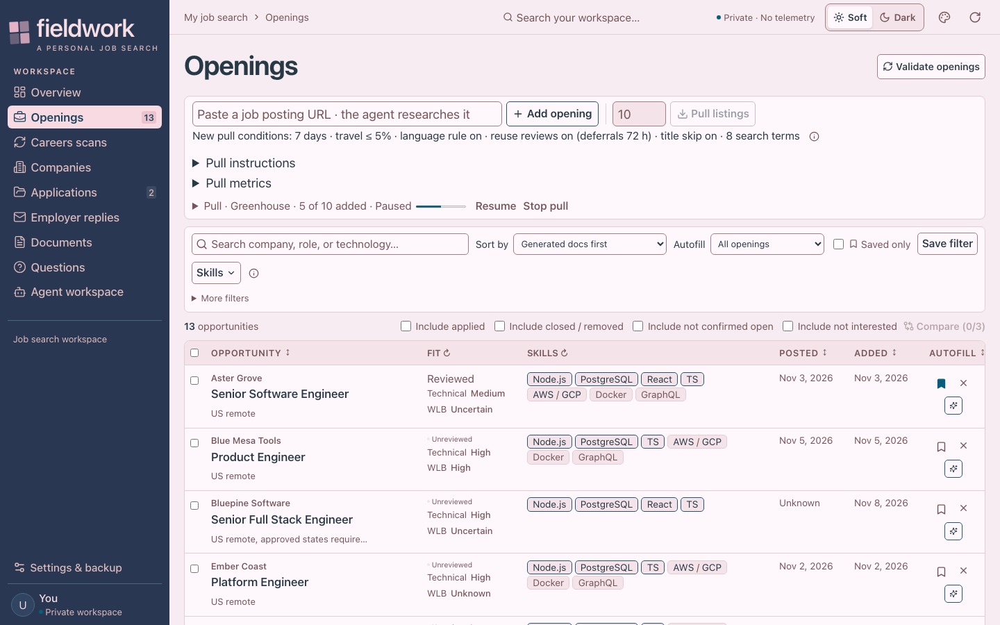
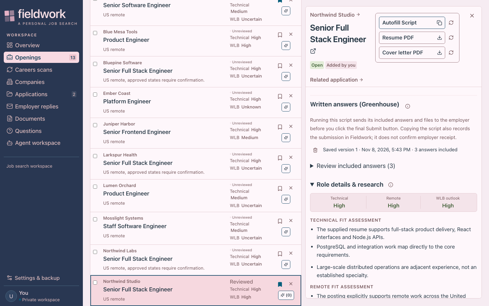

# Fieldwork

Fieldwork is a self-hosted workspace for tracking job openings and applications, researching postings with AI agents (Codex and Claude Code), generating tailored resume and cover-letter PDFs with a native renderer, preparing Greenhouse autofill scripts that never submit an application, drafting follow-up emails, and watching Gmail for employer replies. It is a single-user system built for its author's own job search.

## Screenshots

All data shown is synthetic and produced by `npm run demo`. The demo displays saved example states; it does not connect to employer forms, start agents or make network requests.





| View | What it shows |
| --- | --- |
| [Openings, dark](platform/docs/screenshots/openings-list-desktop-dark.png) | The list in Dark mode. |
| [Applications](platform/docs/screenshots/applications-desktop-soft.png) | Applications at different stages and their next actions. |
| [Follow-up draft](platform/docs/screenshots/application-follow-up-desktop-soft.png) | An editable draft for a saved application. |
| [Greenhouse pull](platform/docs/screenshots/greenhouse-pull-desktop-soft.png) | A paused search with separate search and review activity. |
| [Appearance editor](platform/docs/screenshots/appearance-editor-desktop-dark.png) | Theme controls and a Dark preview. |
| [Opening on a phone](platform/docs/screenshots/opening-detail-phone-soft.png) | Document controls and research at phone width. |

The [screenshot notes](platform/docs/screenshots/README.md) describe the fixture and capture conditions. The images demonstrate interface states, not live integration acceptance.

## Architecture

The backend is Express and SQLite, with a React and Vite TypeScript client. Shared types and validation rules live alongside them in `platform/app/shared/`. Research sources, workflow records and immutable document objects have separate ownership: source files hold research, SQLite holds personal workflow metadata, and content-addressed objects retain captured document bytes. See [architecture](platform/docs/architecture.md).

The application can run locally or with a cloud backend as the data authority and a Mac companion. The companion proxies requests and supplies browser capabilities and native Swift/WebKit PDF rendering. Deployment and authentication are operator-configured, not bundled hosted infrastructure. See [cloud hosting](platform/docs/cloud-hosting.md) and [deployment](platform/deploy/README.md).

```text
React client  -->  Express + SQLite backend  -->  agents / Gmail / Greenhouse
                          ^
                          | authenticated companion connection
                    Mac companion  -->  browser capabilities / native PDF renderer
```

The [agent router](platform/app/server/agent-router.ts) presents a common interface over the Codex app-server and Claude Agent SDK adapters. A [task-kind registry](platform/app/server/task-kinds/registry.ts) defines each task's purpose, instructions, tools, preparation and completion handling. Tasks use captured context and purpose-scoped tools; a thread remains with its owning provider. See [Codex](platform/docs/codex.md), [Claude Code](platform/docs/claude-code.md) and [security](platform/docs/security.md).

A [Greenhouse pull](platform/docs/greenhouse-pull.md) rotates search terms and persists page cursors. Candidates pass deterministic screens before agent review; review memory can reuse decisions bound to captured inputs, and publication applies its own guards. A target for newly saved openings is distinct from completing every search and draining discovered candidates. The [pull orchestrator](platform/app/server/greenhouse-pull.ts) and [opening-pull modules](platform/app/server/opening-pull/) are starting points for the pipeline.

The [preparation queue](platform/app/server/application-preparation.ts) coordinates form inspection, reusable or newly generated documents, written answers and a saved autofill script. The script preserves existing answers and attachments and does not click Submit. Preparation, copying a script, recording a submission and employer receipt are separate events. See [application preparation](platform/docs/application-preparation.md) and the [Opening workflow](platform/docs/opening-workflow.md).

Gmail scanning runs independently of the browser, retaining cursors and coverage across bounded passes. Matching and application updates are separate from drafting and sending follow-ups; sending requires user confirmation. See [Gmail](platform/docs/gmail.md) and [follow-up email](platform/docs/follow-up-email.md). The interface uses [theme-kit](https://github.com/JakeIwen/theme-kit) for palette formulas, with application-specific semantic tokens and per-browser Soft/Dark selection. The adapter and state live in [client/appearance](platform/app/client/appearance/).

## Engineering details

- **Artifact validity and history.** Source and evidence hashes guard reuse and publication; sent packages retain immutable captured bytes even after source edits. Start with [application-evidence.ts](platform/app/server/application-evidence.ts), [preparation-documents.ts](platform/app/server/preparation-documents.ts) and [bundle validation](platform/docs/bundle-validation.md).
- **State projection.** [storage-state-cache.ts](platform/app/server/storage-state-cache.ts) caches deep-frozen Store-derived parts using per-record-kind write versions. Rollbacks and external commits invalidate the cache; file-, clock- and runtime-dependent checks have a request-scoped cache. [state-response-json.ts](platform/app/server/state-response-json.ts) reuses serialized fragments.
- **Recovery and reload.** [resumable-job.ts](platform/app/server/resumable-job.ts) provides shared lifecycle support for scans and validation. [workspace-activity.ts](platform/app/server/workspace-activity.ts) inventories work for an idle-aware reload; [workspace-reload.ts](platform/app/server/workspace-reload.ts) coordinates interruption and draining when a managed reload occurs.
- **Agent boundaries.** Captured task bundles and purpose-specific policies constrain the tools exposed to agent sessions. See [purpose-policies.ts](platform/app/server/task-kinds/purpose-policies.ts) and [Claude session configuration](platform/app/server/claude-code/session.ts). Offline tests do not prove operating-system sandbox enforcement; real execution needs separate acceptance, as described in [security](platform/docs/security.md).
- **Verification and structure.** The fast test tier uses isolated fixtures; the native tier exercises macOS rendering. The full check includes build, formatting, lint, deployment tests and a release fixture where supported. [Client](platform/scripts/check-client-structure.mjs) and [backend](platform/scripts/check-backend-layout.mjs) gates check declared boundaries; [.codeshape/baseline.json](.codeshape/baseline.json) records size and code-shape baselines. Browser and real-agent acceptance are separate from the offline suite.

The [contributor guide](AGENTS.md) maps additional feature owners and executable contracts. Tests and fixtures are under [platform/app/tests](platform/app/tests/), with client tests beside their components.

## Running locally

Node.js 22.13.0 or newer is required. Native PDF rendering and the native test tier require macOS. From the repository root:

```sh
cd platform
npm install
npm run demo
```

The demo builds the client, then serves a disposable copy of the synthetic workspace on a loopback port. It refuses child processes and outbound network connections, so it never starts agents, sends email or runs searches; those actions answer with a disabled message. `npm run demo:screenshots` retakes the images above; it drives a Playwright MCP server that must already be listening at `http://localhost:8931/mcp` (for example `npx @playwright/mcp --port 8931`). The [sample workspace](platform/sample-workspace/README.md) contains fictional source material.

Run the verification tiers from `platform/`:

```sh
npm test
npm run test:native
npm run check
```

`npm test` is the fast tier; `npm run test:native` covers native rendering; `npm run check` runs the complete offline gate. Unsupported platforms explicitly report native limitations rather than establishing native behavior. Real agent use requires your own Codex or Claude sign-in, and Gmail features require your own OAuth setup. A historical reference conversation (`FIELDWORK_REFERENCE_THREAD_ID`) is optional; without one, Questions and document generation still run. For cloud deployment and required environment variables, see [deployment](platform/deploy/README.md).

## How this was built

The code was predominantly written by AI coding agents, OpenAI Codex and Anthropic Claude Code, under Jacob Iwen's direction. He set requirements and product decisions, designed the workflow and its constraints, reviewed and accepted changes, ran browser acceptance testing and operated the deployment for his own job search. Owner decisions and implementation boundaries are recorded in the contributor guide and feature documentation.

This repository is a one-time scrubbed snapshot of a private repository. Personal data, the author's own documents and some features tied to personal accounts were removed or generalized. The sample workspace and its applicant, Sam Rivera, are fictional, and the commit history is not included. The complete offline check (`npm run check`) was rerun on this snapshot on November 8, 2026 and passed: 1,512 fast-tier tests (plus one opt-in benchmark skipped by default), 63 native rendering tests, 54 deployment tests and the release fixture.

## Limitations

Fieldwork is designed for one user and is not a hosted product. Agent and Gmail features depend on external accounts. Greenhouse is the only supported job board for pulls and autofill; Ashby and Lever were evaluated and removed. Native document rendering requires macOS. Offline tests and synthetic screenshots do not replace live integration checks.

## License

This project is licensed under the [MIT License](LICENSE).
